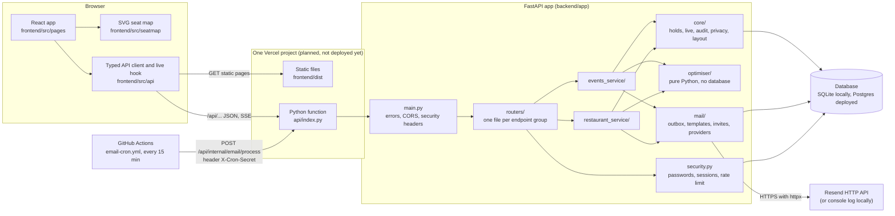
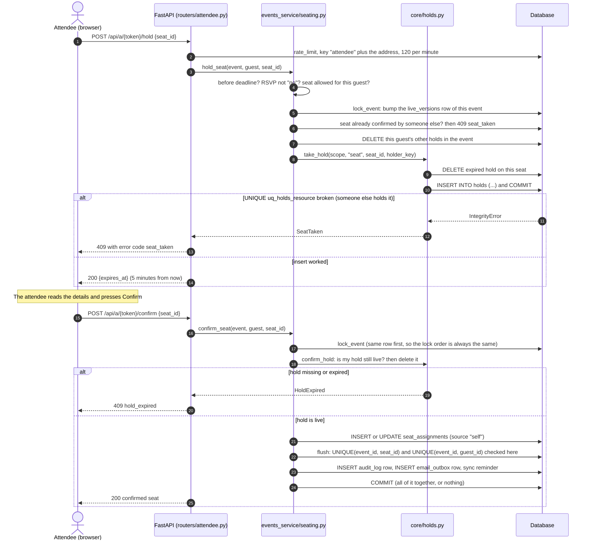
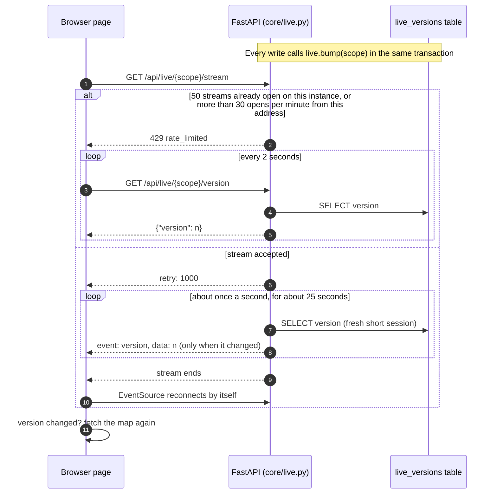
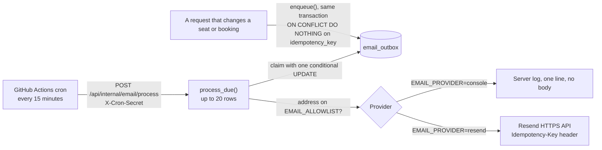
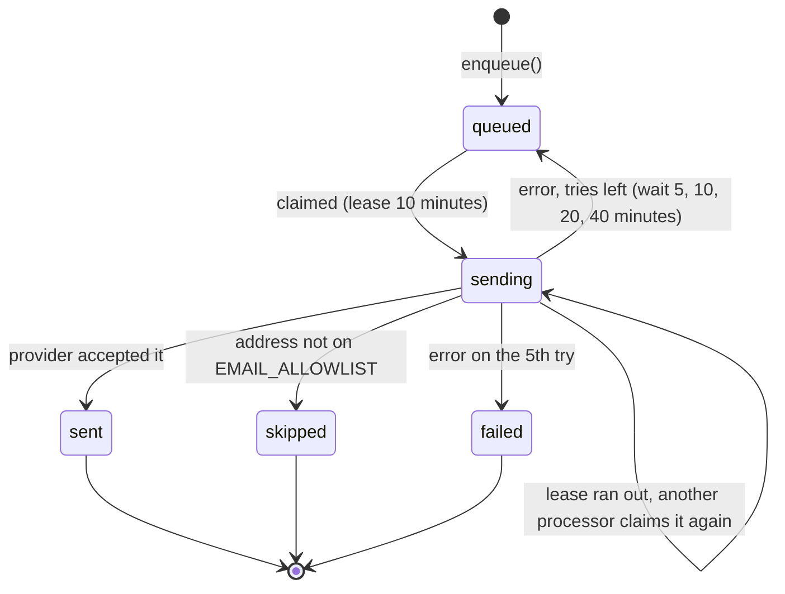

# Architecture

This page explains how the parts of SeatPlan fit together. Every fact here
comes from the code as it was on 2026-11-10; the file names are given so you
can check. The agreement behind it is [`CONTRACT.md`](CONTRACT.md), and the
reasons for each change are in [`decisions-log.md`](decisions-log.md).

## 1. The big picture in four sentences

1. The browser loads a React app (built by Vite) and talks to one Python
   function through `/api/...` on the same address.
2. The Python function is a FastAPI app (`backend/app/main.py`) that reads and
   writes one database: SQLite on a laptop, Postgres when deployed.
3. The database, not the Python code, decides who gets a seat or a table: every
   seat, table slot and hold is protected by a UNIQUE constraint
   (see [`data-model.md`](data-model.md)).
4. Two things happen outside a browser request: live updates (the browser asks
   "has anything changed?") and emails (a scheduled job asks the API to send
   what is waiting in the outbox).

## 2. Components

What each part does, in one line each:

| Part | Job | Where |
|---|---|---|
| Vercel entry point | Puts `backend/` on the import path and builds the app once | `api/index.py` |
| App factory | Registers routers under `/api`, error shape, CORS, security headers | `backend/app/main.py` |
| Settings | Reads every environment variable, refuses unsafe start-ups | `backend/app/config.py` |
| Database helpers | Engine (NullPool on Postgres), session per request, `create_all` | `backend/app/db.py` |
| Routers | Thin HTTP layer: check input, call a service, return JSON | `backend/app/routers/` |
| Services | The real work for each vertical | `backend/app/events_service/`, `backend/app/restaurant_service/` |
| Core | Holds, live counter, audit log, privacy names, layout save | `backend/app/core/` |
| Optimiser | Pure functions; routers turn rows into dataclasses and call them | `backend/app/optimiser/` |
| Mail | Outbox table, templates, calendar invites, providers | `backend/app/mail/` |
| Seed | Demo data and the `migrate` command that creates tables on Postgres | `backend/app/seed/` |

Two rules keep this picture simple:

- **The optimiser never imports the database.** It receives frozen
  dataclasses and returns plain results, so it can be tested on its own.
- **No shared memory between requests.** On Vercel each request may run on a
  different instance, so everything that must be shared (holds, live version
  numbers, rate-limit counters, the email queue) lives in the database.

## 3. Request flow: an attendee holds and confirms a seat

The attendee opens `/e/<token>` in the browser; the frontend calls the API
under `/api/a/<token>/...`. The code is `routers/attendee.py`,
`events_service/seating.py` (`hold_seat`, `confirm_seat`) and `core/holds.py`.
A hold lasts 5 minutes (`HOLD_MINUTES = 5`).

Why it is safe even when two people press at the same moment on two different
servers: both servers try an `INSERT`, and the database accepts only one. The
loser gets a clean 409, never a 500 and never a double booking. On Postgres, if
the database breaks a deadlock or a serialization conflict (sqlstate `40P01`
or `40001`), `main.py` answers 409 `conflict` "please try again", and nothing
was saved.

The restaurant flow has the same shape. `POST /api/r/{vid}/hold` takes one
`holds` row per table per 15-minute slot (scope `venue-<id>-<yyyy-mm-dd>`,
`slot_key` = slot number), and `POST /api/r/{vid}/bookings` turns the hold into
`table_slots` rows, whose primary key `(table_id, date, slot_index)` refuses a
second booking of the same table in the same slot.

## 4. Live updates

Code: `backend/app/core/live.py` (server) and the live hook in
`frontend/src/api/` (browser). Only a version number travels; the page then
fetches its data again with the normal endpoints.

Numbers from the code: `STREAM_SECONDS = 25.0`, `CHECK_EVERY_SECONDS = 1.0`,
`STREAMS_PER_IP_PER_MINUTE = 30`, `MAX_OPEN_STREAMS = 50`. Scopes are
`event-<event public id>` and `venue-<venue public id>-<yyyy-mm-dd>`.

Why this design: a serverless function cannot keep a socket open for long and
does not share memory with other instances. A short stream that ends by itself
and a counter in the database work under both limits. Not checked yet: whether
Vercel buffers the stream. If it does, changes arrive late instead of falling
back to polling (see [`risk-log.md`](risk-log.md)).

## 5. Email outbox

Code: `backend/app/mail/outbox.py`, `backend/app/routers/emails.py`,
`backend/app/mail/providers.py`, `.github/workflows/email-cron.yml`. More
detail in [`email.md`](email.md).

Emails are never sent during a booking request. The request only writes a row
into `email_outbox` in the same transaction as the booking, so a rolled-back
booking leaves no email behind, and a slow email provider can never make a
booking fail.

Life of one row (the `status` column):

Numbers from the code: `MAX_ATTEMPTS = 5`, `FIRST_RETRY_DELAY = 5 minutes`
(doubling), `CLAIM_LEASE = 10 minutes`, batch of 20 per call, and the
processing endpoint is rate limited to 30 calls per minute per address before
the secret is checked.

## 6. Security in the request path

- **Sessions:** organiser and staff send `Authorization: Bearer <session>`,
  an HMAC-signed value that expires after 12 hours (`SESSION_HOURS = 12` in
  `security.py`). Passwords are hashed with `hashlib.scrypt`.
- **Personal links:** attendee (`/a/<token>`) and booking (`/b/<token>`) tokens
  are stored only as SHA-256 hashes. A wrong and a revoked token both give 404.
- **Rate limits** live in the `rate_limits` table, so they work across
  serverless instances. Fixed window per calendar minute: login 10 per minute
  per address, attendee routes 120, demo reset 5, email processing 30, live
  stream opens 30.
- **Headers:** `main.py` adds `nosniff`, `X-Frame-Options: DENY`,
  `Referrer-Policy: no-referrer`, HSTS, a Permissions-Policy and
  `Cache-Control: no-store`. `vercel.json` adds a Content-Security-Policy and
  the same framing rules to the static frontend.
- **CORS** allows only `FRONTEND_ORIGIN`.

## 7. Where things run

| Piece | Locally | Deployed (planned, not done yet) |
|---|---|---|
| Frontend | `npm run dev` on port 5173, forwards `/api` to port 8000 | Static files from `frontend/dist` on Vercel |
| Backend | `uvicorn app.main:create_app --factory` on port 8000 | `api/index.py` as one Vercel Python function, `maxDuration` 30 s |
| Database | `backend/seatplan.db` (SQLite), tables made at start-up | Hosted Postgres (Neon through the Vercel Marketplace); tables made by `python -m app.seed.migrate` |
| Email | Console provider (prints one line) | Resend, only once a sending domain is verified |
| Cron | Call the endpoint by hand with `curl` | `.github/workflows/email-cron.yml` every 15 minutes |

The deployment steps are in [`deployment.md`](deployment.md). Day-to-day
commands and fixes are in [`runbook.md`](runbook.md).
