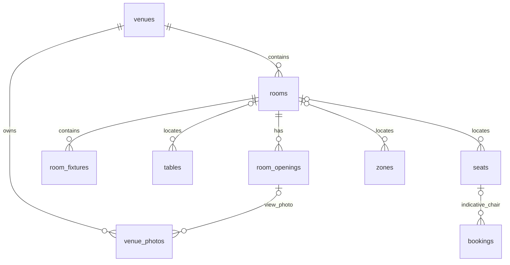
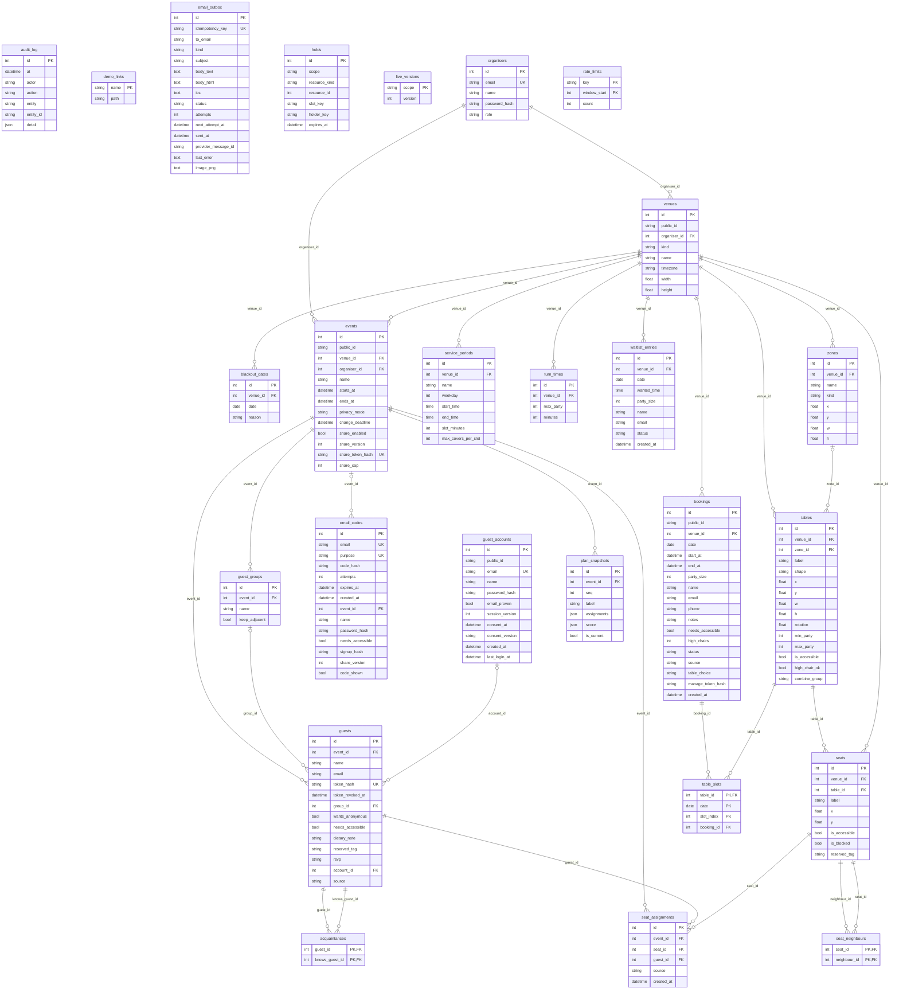

# Data model

All tables live in one file, `backend/app/models.py` (SQLAlchemy 2, typed
style). There are 30 tables after the restaurant platform foundation:
12 shared, 8 for events and 10 for
restaurants. The same code runs
on SQLite (laptop and tests) and Postgres (deployment).

| Group | Tables |
|---|---|
| Shared | `organisers`, `venues`, `zones`, `tables`, `seats`, `seat_neighbours`, `live_versions`, `holds`, `email_outbox`, `audit_log`, `rate_limits`, `demo_links` |
| Events | `events`, `guest_groups`, `guests`, `acquaintances`, `seat_assignments`, `plan_snapshots`, `guest_accounts`, `email_codes` |
| Restaurants | `service_periods`, `turn_times`, `blackout_dates`, `bookings`, `table_slots`, `waitlist_entries`, `rooms`, `room_openings`, `room_fixtures`, `venue_photos` |

The restaurant extension adds nullable room references to zones, tables and
seats, is_active to tables, chosen_seat_id and prefs to bookings, and the public
profile, slug, status, location, features and layout version to venues. The
nullable slug has a unique index. Migration preserves existing layout rows
without creating rooms. Photos store bounded bytes and an optional opening
reference. The diagram below records the frozen 2026-11-10 baseline. These
additions follow specification section 11.

## Restaurant extension in use (2026-11-13)

The original diagram below is retained as historical context. The added
relationships are:



`venues` holds the nullable unique slug, profile/location, `status`,
`published_at`, derived `features` and `layout_version`. Owner creation sets
draft explicitly; legacy rows default to published. `rooms.outline` is JSON
with clockwise screen points and signed outgoing sagitta; openings reference
an outline side by index and position by centimetres along its arc. Canonical
read keys are r/o/f/z/t/s followed by the row ID; save replies retain incoming
browser keys so selections remain stable.

Room writes compare-and-increment `layout_version` atomically, upsert stable
IDs, delete missing children safely and rebuild seat neighbours in one
transaction. Booking slots, chosen seats, booking audit history and live holds
protect table deletion; legacy bookings with no surviving table association
conservatively protect all tables. Combine-group names remain unchanged in the
database and API; the optimiser adapter namespaces them by room.

`bookings.prefs` stores normalized wishes; `chosen_seat_id` is indicative and
does not introduce a second reservation/hold. Moving assigned tables clears an
invalid chair choice. The manage link continues to resolve an existing booking
when its venue is draft. An invalid edit after explicit publication changes
status to draft in the same transaction, preserving the timestamp and stable
slug; repairing and publishing again reopens new bookings.

`venue_photos` stores at most 800000 decoded bytes per image, bounded to 1600 px,
with at most ten gallery photos and one view photo per opening. Metadata reads
defer bytes; draft image reads are authenticated/private. Deleting an opening
removes its view photo first. Published immutable caches cannot be revoked.

No new migration was needed for the final integration fixes. The frozen
2026-11-13 pre-extension fixture and repeated-upgrade tests verify preservation
of existing IDs and rows. PostgreSQL runs still require
`SEATPLAN_TEST_POSTGRES`; final local verification used SQLite.

## How the diagram was made

The diagram is not drawn by hand. It was printed by a small script that reads
`Base.metadata` from `app.models` (every column, primary key, foreign key and
`unique=True` flag), run on 2026-11-10 from `backend/`:

```bash
cd backend
PYTHONPATH=. ../.venv/bin/python <script>.py
```

The script itself was kept outside the repository (scratch folder). To check
the diagram after a model change, list the tables and their columns with:

```bash
cd backend
../.venv/bin/python -c "from app.models import Base; [print(t.name, [c.name for c in t.columns]) for t in Base.metadata.sorted_tables]"
```

Reading the diagram: `PK` primary key, `FK` foreign key, `UK` a column with
its own UNIQUE constraint. `||--o{` means "one to many"; `o|--o{` means the
foreign key may be empty (NULL). Column types are shortened: `datetime` is
the `UtcDateTime` type in `models.py`, which stores UTC and always gives back
timezone-aware values.



Things the diagram cannot show:

- `holds` has no foreign key on purpose: `resource_id` points at a seat or a
  table depending on `resource_kind`, and `scope` says which event or which
  restaurant day it belongs to.
- `seat_neighbours` stores both directions (A next to B and B next to A).
- Guest accounts (`docs/guest-accounts.md`, section 3): `guests.account_id` is
  set when a guest account owns the row; `guests.source` is `invited` or
  `self_registered`. An organiser-erased row keeps its `account_id` (no
  personal data) so that account cannot join that event again; deleting the
  account clears it. `email_codes` holds pending sign-ups and reset codes,
  one per address and purpose, only as keyed hashes; rows expire after 15
  minutes and the email cron deletes them. `email_outbox.image_png` is the
  Base64 seat picture of an account holder's seat email. On SQLite,
  `guest_accounts` is made with `AUTOINCREMENT` so ids are never reused.
- `acquaintances` is directed: "Ana knows Bruno" does not mean "Bruno knows Ana".
- `plan_snapshots.assignments` and `.score` are JSON. The format is in
  decisions log, "events vertical API", item 3.
- `public_id` (venues, events, bookings) and `bookings.manage_token_hash` are
  indexed but not UNIQUE (decisions log, "backend foundation", item 6): they
  hold 9 random bytes (72 bits) from `secrets.token_urlsafe(9)`.

## The rules that make double booking impossible

The contract (section 4, "No double booking, ever") says the database decides,
not the application. These are the constraints that do it. Each one is in
`models.py` and was listed from `Base.metadata` by the script above.

| Table | Constraint (name in `models.py`) | Columns | What it stops | What the user sees |
|---|---|---|---|---|
| `holds` | `uq_holds_resource` (UNIQUE) | `scope, resource_kind, resource_id, slot_key` | Two people holding the same seat, or the same table in the same 15-minute slot, at once | 409 `seat_taken` |
| `seat_assignments` | `uq_assignment_seat` (UNIQUE) | `event_id, seat_id` | Two guests in one seat at one event | 409 `seat_taken` |
| `seat_assignments` | `uq_assignment_guest` (UNIQUE) | `event_id, guest_id` | One guest owning two seats at one event | 409 `seat_taken` |
| `table_slots` | Primary key | `table_id, date, slot_index` | Two bookings on one table in the same 15-minute slot | 409 `seat_taken` |

Details that matter for these four:

- `holds.slot_key` is never NULL (default `""` for seats). SQL treats NULLs as
  all different, so a NULL slot key would let two holds slip past the rule.
- Expired holds are deleted inside the same transaction that tries to take the
  resource (`core/holds.py`, `take_hold`), so an old hold never blocks anyone.
- A booking that becomes `completed`, `no_show` or `cancelled` deletes its
  `table_slots` rows, so the table is free again (decisions log, "restaurants
  vertical API", item 10).
- What has **no** UNIQUE rule: the restaurant covers cap
  (`max_covers_per_slot`). The application checks it after locking the
  service period's row (`restaurant_service/availability.py`,
  `_lock_period`), so two simultaneous bookings are checked one after the
  other and cannot pass it together (test
  `test_covers_cap_holds_under_concurrent_confirms`). This replaces the older
  note in the decisions log ("restaurants vertical API", item 6). Tables
  themselves can never be double booked.

## Other unique rules

These do not stop double booking of a seat, but they stop other duplicates.

| Table | Constraint | Columns | What it stops |
|---|---|---|---|
| `email_outbox` | UNIQUE | `idempotency_key` | The same email being queued twice (insert uses `ON CONFLICT DO NOTHING`) |
| `plan_snapshots` | `uq_snapshot_seq` (UNIQUE) | `event_id, seq` | Two scenarios with the same number in one event |
| `guests` | UNIQUE | `token_hash` | Two guests sharing one personal link |
| `guests` | `uq_guests_event_account` (UNIQUE index) | `event_id, account_id` | One account with two rows on one event (NULLs never clash, so invited guests without an account are not limited) |
| `events` | `uq_events_share_token` (UNIQUE index) | `share_token_hash` | Two events answering the same shared link |
| `guest_accounts` | UNIQUE | `email` | Two accounts for one address (two verifies at once: one gets 409 "Please try again.") |
| `email_codes` | `uq_email_codes_email_purpose` | `email, purpose` | Two live codes for one address and purpose |
| `organisers` | UNIQUE | `email` | Two accounts with the same email |
| `live_versions` | Primary key | `scope` | Two counters for one event or one restaurant day |
| `rate_limits` | Primary key | `key, window_start` | Two counters for the same client in the same minute |
| `acquaintances` | Primary key | `guest_id, knows_guest_id` | The same "knows" pair twice |
| `seat_neighbours` | Primary key | `seat_id, neighbour_id` | The same neighbour pair twice |
| `demo_links` | Primary key | `name` | Two demo links with the same name |

Every other table has a plain integer `id` primary key.

## Conventions

- **Integer ids stay inside the database.** URLs use a random `public_id` or a
  secret token, so records cannot be counted or guessed.
- **Secret tokens are stored as SHA-256 hashes** (`guests.token_hash`,
  `bookings.manage_token_hash`). The raw token is shown once, in the answer
  that created it. The only raw tokens kept on purpose are in `demo_links`,
  which every demo reset wipes.
- **All times are UTC** in the database (`UtcDateTime`). Restaurant dates and
  slot times are worked out in the venue's own `timezone`.
- **Erasing a guest keeps the row** as "Deleted guest" with no email, so old
  plan snapshots still make sense (decisions log, "events vertical API", item 11).

## Changing the schema

There is no general migration tool. On SQLite the app creates missing tables
when it starts. On Postgres only `cd backend && python -m app.seed.migrate`
changes the schema. In one transaction (after a Postgres advisory lock, or
`BEGIN IMMEDIATE` on SQLite) it creates missing tables, then adds each column
of `NEW_COLUMNS` that is missing (`ALTER TABLE ... ADD COLUMN`, with `IF NOT
EXISTS` on Postgres) and each index of `NEW_INDEXES` (`CREATE ... INDEX IF NOT
EXISTS`). Today those lists hold the 7 columns and 3 indexes of guest
accounts. Running it again changes nothing. Any other change to an existing
table still needs a hand-written `ALTER TABLE` or a fresh database. The test
`backend/tests/test_migrate_guest_accounts.py` starts from the frozen old
schema (`backend/tests/fixtures/schema_2026_11_10.*.sql`) on SQLite and, with
`SEATPLAN_TEST_POSTGRES`, on Postgres. See [`runbook.md`](runbook.md) and
[`deployment.md`](deployment.md).
